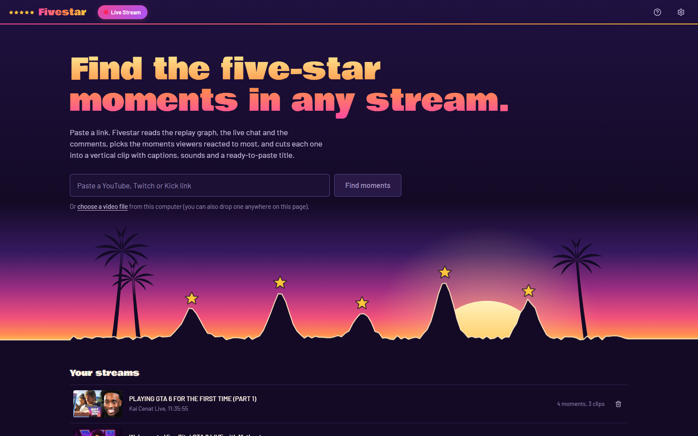
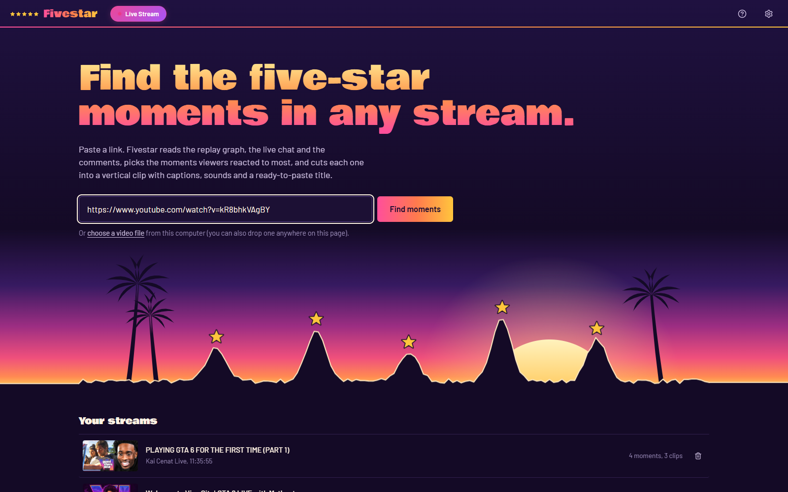
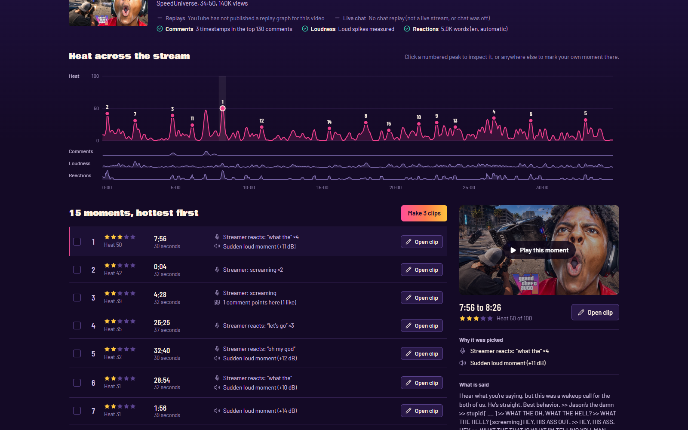
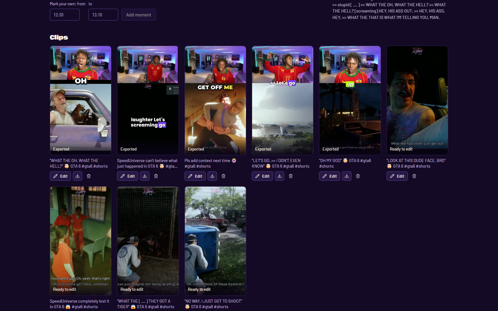
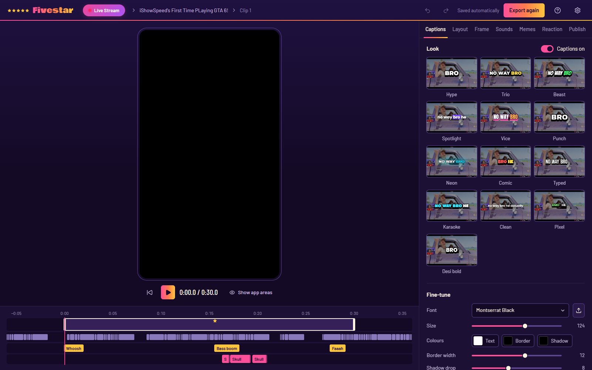
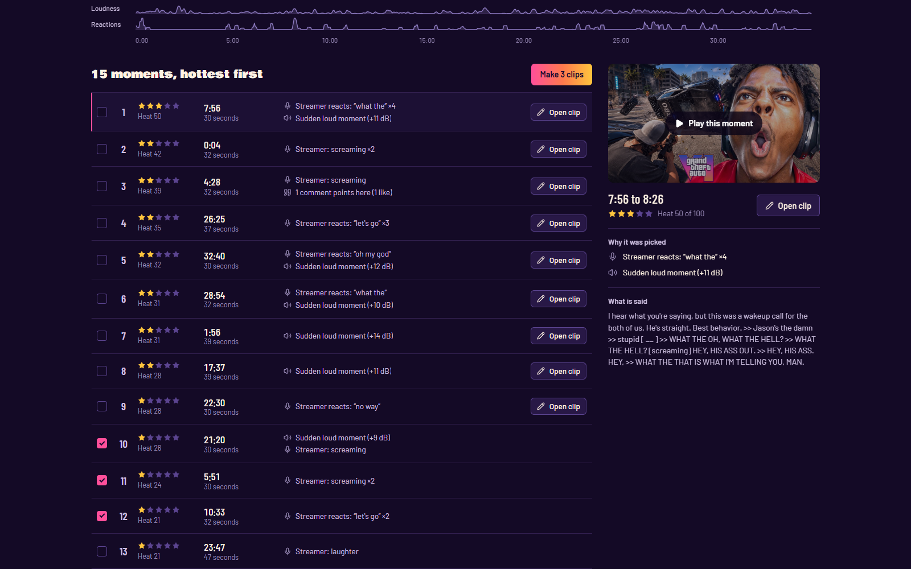
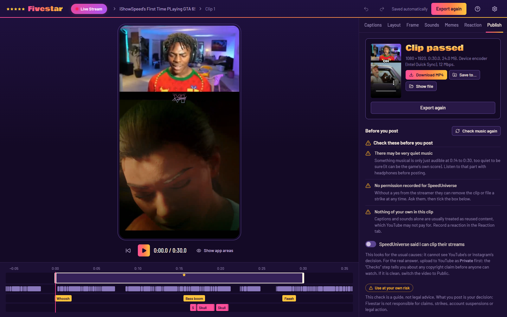

# Fivestar — local app

This folder contains the prebuilt app. The backend serves the frontend too, so only one command
and one local server are needed. There is no development source, build step, account, subscription,
or environment file to configure.

**Designed and coded by Jainil Patel**

## Why we built this

Turning a long stream into short clips is slow, repetitive work. A creator has to watch hours of footage, guess which moments viewers actually enjoyed, note the timestamps, reframe each one to vertical, caption it, add sounds and write a title. Most of that is mechanical, and doing it by hand makes it easy to miss the parts that performed best.

Fivestar automates that judgement. It reads the signals the platform already records - the most-replayed graph, spikes in live chat, comments pointing at a timestamp, sudden loud reactions and the spoken transcript - and combines them into one heat score. The app then surfaces the strongest moments, explains why each one was picked, and cuts only those 30 to 60 second sections. It runs locally, so there is no account, no subscription and no monthly quota.

## What it is used for

- **Clip a long stream into Shorts, Reels or TikToks.** Paste a YouTube, Twitch or Kick link, or drop a local video file, and get a ranked list of moments worth publishing.
- **Find the moments viewers reacted to.** The heat graph overlays comments, loudness and reactions so you can see where the audience actually engaged instead of scrubbing blindly.
- **Create vertical clips with captions and effects.** Each clip is reframed to 9:16 with word-by-word captions, meme sounds, reaction effects, a title, description and hashtags.
- **Edit before exporting.** Adjust timing, captions, look presets, fonts, colours and sounds in the clip editor, then export an MP4.
- **Work on your own machine.** Projects, exports and cached models are stored in `data/` on your computer. You upload the finished clips yourself.

> Fivestar is an independent tool, not affiliated with YouTube, Instagram, Twitch, Kick or Rockstar Games. Use media you own or have permission to use.

## UI overview

Seven screenshots showing the Fivestar interface, from the landing page through to the clip editor.

### 1. Hero section

The landing page: paste a stream or video link, or drop a local file, then browse saved streams.



### 2. Add a YouTube link

Paste a YouTube, Twitch or Kick link and choose **Find moments**.



### 3. Editor - all graphs

The analysis view shows the signal cards and the combined **Heat across the stream** graph with numbered peaks.



### 4. Clips

Generated clips with titles, export status and an **Edit** link for each one.



### 5. Clip editor

The clip editor: timeline, captions, look presets, sounds, memes and publish options.



### 6. Moments list

Moments ranked by heat score, each with the reason it was picked and a link to open its clip.



### 7. Publish

The publish panel with export status, pre-post checks, and a ready title, description and hashtags.



## Required tools

- Node.js **22.12 or newer**, including npm.
- Python 3 with pip and venv support (to install yt-dlp), or a working system installation of yt-dlp.
- FFmpeg, including **ffmpeg** and **ffprobe**, on your PATH.
- A modern browser; Chrome or Edge is recommended.
- Internet for initial installation, model downloads, and online streams or music searches.

macOS with Homebrew already installed:

```bash
brew install node@22 python ffmpeg
```

Follow Homebrew's PATH instructions for Node 22, and reopen your terminal.

Ubuntu / Debian / WSL2: install Node.js 22.12+ separately, then:

```bash
sudo apt update
sudo apt install python3 python3-venv python3-pip ffmpeg
```

For Windows, use WSL2 and install these tools inside WSL. Open the app in your Windows browser.
The build has been checked on macOS; other operating systems need their own verification.

## First run

Open a terminal in this folder, where `package.json` is located:

```bash
npm ci --omit=dev
npm run setup
npm start
```

Open **http://localhost:5177**. Keep the terminal running. Press **Ctrl+C** to stop.
Future runs need only `npm start`. No Vite, TypeScript, tsx, or separate frontend command is needed.
Dependencies with native components install for this computer; do not copy another computer's
`node_modules` or `.tools/venv` folders.

## Check installation

```bash
npm run guide
```

Open **http://127.0.0.1:5180** and press **Check installation**. Fix missing items and check again.
This checks prerequisites; it does not start the app. Keep it in a separate terminal if needed.
The HTML instructions at `docs/setup.html` can also be read directly, but checks need the guide server.

## Using the app

Paste a replay link or choose a video file, select moments, create clips, edit, then export MP4.
The `?` button explains the editor. The gear button changes local preferences.
You upload completed clips to your chosen platform yourself.

- All editing features and exports are available without monthly quotas.
- Your projects, uploads, exports, imports, preferences and cached models are in **data/**.
- Back up **data/**. Do not delete it when replacing the app's build files.
- Setup assets are in **assets/**. The downloader's local Python environment is in **.tools/**.
- Downloading models the first time can take a while. Local media processing runs on this computer;
  stream access, music search, package installation and model downloads contact external services.

## Troubleshooting

- Missing command: install the named tool, fix PATH, reopen your terminal, and restart the app.
- Missing packages: run `npm ci --omit=dev` again.
- Missing assets: run `npm run setup` again. Setup is safe to repeat.
- YouTube links fail: run `npm run setup -- --update` to update yt-dlp.
- Restricted video: Settings can borrow YouTube sign-in from a browser on the computer running
  the backend. It cannot read a phone's or another machine's browser cookies. WSL may not be able
  to read Windows browser profiles. Leave this set to Nothing for public videos.
- Port 5177 in use: stop the previous copy before starting this one.
- Hardware export fails: choose Software encoder in Settings.

Use media you own or have permission to use, and retain required music and asset credits. The
risk check cannot guarantee a platform's copyright or monetisation decision. Dependency licences
remain in their installed packages; browser asset notices are retained in the build.
